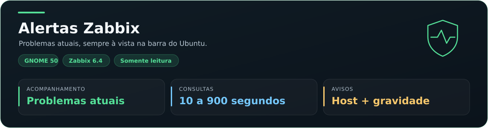
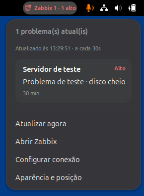
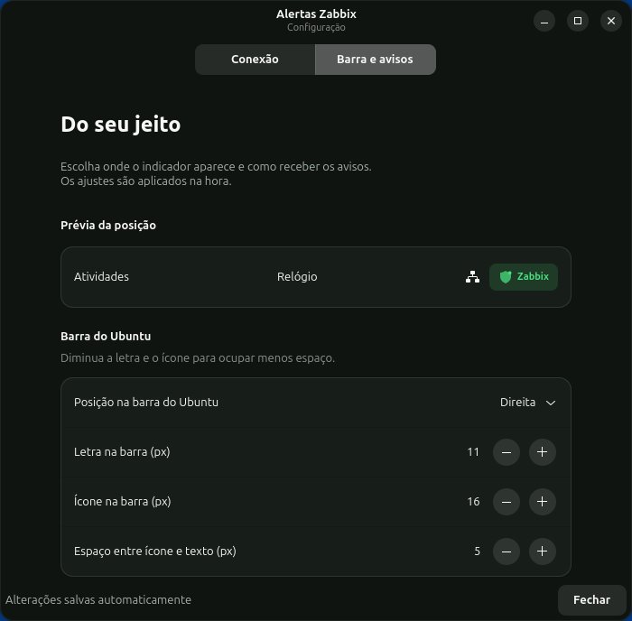

<p align="center">
  
</p>

# 🛡️ Alertas Zabbix



**Acompanhe os problemas do Zabbix sem manter o dashboard aberto.**

[Prints](#-em-funcionamento) · [Começar](#-instalação) · [Conectar](#-conexão) · [Personalizar](#-aparência-e-posição-na-barra) · [Alertas](#-comportamento) · [Templates](#-templates-de-monitoramento-no-zabbix) · [Ajuda](#-dúvidas-e-soluções)

---

Extensão independente para Ubuntu/GNOME 50, integrada à API do Zabbix 6.4.
Mostra permanentemente na barra a quantidade de problemas ativos, a maior
gravidade e quantos problemas têm essa gravidade, por exemplo `Zabbix 5 · 1 alto`.
A cor acompanha a maior severidade. Sem problemas, mostra `Zabbix OK` em verde.
Ao clicar no indicador, o menu apresenta diretamente os problemas atuais com host,
severidade, duração e reconhecimento em cartões, além da hora da consulta. Clique num problema para abrir seu evento
no navegador. A lista do menu mostra até 40 problemas; o contador inclui todos
os problemas do filtro e há um link para consultar a lista completa no Zabbix.

## ✨ O que você encontra

| Recurso | Como funciona |
| :--- | :--- |
| 🟢 Indicador permanente | Quantidade de problemas e destaque para a maior gravidade. |
| 🖥️ Problemas por host | Cartões com severidade, duração, reconhecimento e acesso ao evento. |
| 🔔 Avisos do Ubuntu | Resumo inicial e notificações de problemas novos ou com gravidade aumentada. |
| 🎨 Aparência ajustável | Posição à esquerda/direita, tema, letras, ícone e espaçamento. |
| 🔐 Conexão configurável | Usuário/senha ou token de API, com credenciais no chaveiro do Ubuntu. |
| 🧩 Templates GEST | Materiais separados para sites, servidores web, banco e notificações. |

```text
Sem problemas:       Zabbix OK
Com problemas:       Zabbix 5 · 1 alto
Falha na consulta:   !  + horário da última consulta válida no menu
```

Os exemplos ilustram o indicador; os valores reais vêm do seu servidor.

## 📸 Em funcionamento

Capturas da interface real em uma sessão GNOME isolada, em **17/11/2026**.
O problema exibido é um **dado de teste identificado**; as telas de configuração
estão sem endereço, usuário ou credencial pessoal.

### Indicador e problemas atuais

O indicador destaca a maior gravidade. Ao clicar, o menu mostra o host, o
problema, a duração e os atalhos de atualização e configuração.



<details>
<summary><strong>Ver as telas de conexão e personalização</strong></summary>

### Configuração da conexão

Endereço e autenticação são preenchidos pela interface, com botões para testar
e salvar o acesso.


### Aparência e posição

Prévia da barra e ajustes de posição, tamanho da letra, ícone e espaçamento.



</details>

## 🚀 Instalação

```bash
cd /var/www/html/alert_zabbix
python3 instalar.py
```

> **Depois de atualizar:** salve o trabalho e saia/entre na sessão se o GNOME ainda estiver usando o código anterior. O instalador não encerra a sessão por conta própria.

O instalador não precisa de sudo, preserva as outras extensões e cria backup nas
atualizações, em `${XDG_DATA_HOME:-~/.local/share}/alert-zabbix/backups`, fora do
projeto. Backups de versões anteriores são movidos para esse local na atualização.
Se o GNOME ainda não reconhecer o novo UUID, salve seu trabalho,
saia da sessão do Ubuntu e entre novamente. A ativação fica salva para esse login.
O instalador não encerra a sessão. Dependências: GNOME 50, GJS, Python 3 com
PyGObject, GTK 4, libadwaita e libsecret (Secret Service/chaveiro desbloqueado).

## 🔐 Conexão

Abra **Alertas Zabbix** no menu de aplicativos ou **Configurar conexão** no indicador.
Também é possível abrir a configuração diretamente:

```bash
python3 extension/configurar.py
```

A primeira abertura apresenta os campos de endereço e usuário vazios. Informe o
endereço que você usa no navegador (por exemplo, `https://zabbix.example.test/zabbix`)
e escolha usuário/senha ou token de API. **Testar conexão** consulta o servidor sem
salvar os dados; **Salvar conexão** valida o acesso e salva a configuração.
O status da tela informa o resultado e quantos problemas estão abertos.
Um campo de credencial vazio mantém a credencial salva
para a mesma combinação de endereço, usuário e modo de autenticação. Alterar essa
combinação exige informar uma credencial correspondente. O servidor precisa ser
acessível pela rede local ou VPN.

A senha/token fica no chaveiro do Ubuntu, fora do projeto e do pacote instalável.
As preferências sem credenciais ficam em
`${XDG_CONFIG_HOME:-~/.config}/alert-zabbix/settings.json`, com permissão 600.
O código e o pacote não incluem endereço de servidor, conta ou credencial pessoal.
Conexões existentes são preservadas na configuração da conta local. A tela mostra
se o endereço usa HTTP ou HTTPS; em HTTP o tráfego de autenticação não é
criptografado. A validação de certificados HTTPS permanece habilitada.
Redirecionamentos HTTP não são seguidos.

## 🎨 Aparência e posição na barra

| Ajuste | Opções |
| :--- | :--- |
| Posição | Esquerda ou direita da barra do Ubuntu. |
| Tema da janela | Escuro, claro ou seguir sistema. |
| Letra na barra | 9–20 px. |
| Ícone na barra | 10–32 px. |
| Espaço entre ícone e texto | 2–20 px. |
| Letra da janela | 11–18 px. |
| Frequência da consulta | 10–900 s; padrão de 30 s. |

O visual segue o Monitor Global: fundo escuro com destaque verde, cartões e
informações separadas por função. A janela tem as abas **Conexão** e **Barra e avisos**.
O menu do indicador também oferece **Aparência e posição**, que abre a segunda aba.

Em **Barra e avisos → Posição na barra do Ubuntu**, escolha **Esquerda** ou
**Direita**. A prévia acompanha a seleção e o indicador se move assim que a
extensão recebe o ajuste, sem reiniciar a sessão. A posição é preservada nos
próximos logins. Os temas **Escuro**, **Claro** e **Seguir sistema** ajustam a janela.
No mesmo local, **Letra na barra**, **Ícone na barra** e **Espaço entre ícone e
texto** permitem deixar o indicador menor. A prévia acompanha os ajustes. Os
limites são 9–20 px para a letra, 10–32 px para o ícone e 2–20 px para o espaço.
Em **Janela do aplicativo**, ajuste também **Letra da janela**, de 11–18 px.
Essas preferências são salvas automaticamente e podem ser alteradas mesmo sem
conexão com o servidor. A conexão cadastrada e a credencial são preservadas.

É possível abrir essa aba diretamente pelo terminal:

```bash
python3 extension/configurar.py --appearance
```

Após instalar uma versão nova do código da barra, pode ser necessário sair e
entrar na sessão uma vez para carregar a atualização. A tela verifica a versão
em execução: se o GNOME ainda estiver usando uma versão anterior, mostra um
aviso de atualização pendente e informa que a posição está salva para o próximo
login. Esse aviso também se aplica aos tamanhos da letra e do ícone. A prévia
representa a escolha; ela não confirma o estado atual do indicador.

## 🔔 Comportamento

- Atualiza a cada 30 segundos por padrão, configurável entre 10 e 900 segundos.
- Permite filtrar pela severidade mínima.
- Consulta problemas não resolvidos e não suprimidos, visíveis ao usuário da API.
- Hosts com monitoramento desativado no Zabbix ficam fora da lista, do contador
  e das notificações. A alteração é percebida na próxima consulta. Triggers
  desativadas também são excluídas. Em triggers com vários hosts, todos precisam
  estar com monitoramento habilitado.
- Um host habilitado que ficou indisponível continua gerando alertas: perder
  conexão com o equipamento é diferente de desativar seu monitoramento no Zabbix.
- Problemas resolvidos saem da lista na próxima atualização. A consulta usa
  `recent: false` e exclui eventos que já possuem evento de recuperação.
- Em falhas de rede, mostra `!`, esconde a lista anterior e informa a hora da última
  consulta válida. A lista volta após uma consulta bem-sucedida.
- O indicador acompanha somente os problemas atuais, sem totais de hosts ou histórico.
- Avisos nativos do Ubuntu mostram um resumo dos problemas atuais ao iniciar e
  avisam quando aparece um novo problema ou quando sua gravidade aumenta. Cada
  atualização agrupa os avisos em uma notificação; problemas sem mudanças não
  repetem o aviso. O filtro de severidade também se aplica aos avisos.
- Em Configurar conexão, **Avisar na tela** permite desligar as notificações.
  Elas seguem as preferências de notificações e Não perturbe do Ubuntu.
  O acompanhamento funciona enquanto a extensão estiver ativa na sessão.
- Ao recusar o login ou as permissões, pausa as tentativas automáticas. Corrija em
  Configurar conexão ou use Atualizar agora após resolver a causa.
- Utiliza apenas consultas da API, além de login/logout da própria sessão. Não
  reconhece, encerra ou altera eventos, hosts ou configurações do Zabbix.
- Senhas são usadas em sessões curtas, encerradas após cada consulta. Tokens de API
  são usados diretamente e não recebem logout.

> **Host desativado × host indisponível:** desativar o monitoramento exclui o host do aplicativo. Um host habilitado que parou de responder continua elegível para alertas gerados pelo Zabbix.

> **Consulta × detecção:** escolher 10 s reduz a espera para buscar um problema já registrado. A frequência dos itens, as triggers e as ações do servidor determinam quando o Zabbix detecta e envia o alerta.

O cliente foi preparado especificamente para Zabbix 6.4; outras versões apresentam
uma mensagem de incompatibilidade. O UUID é `alert-zabbix@gezer.local`.

## 🛠️ Desenvolvimento

```bash
bash empacotar.sh
dbus-run-session -- gnome-shell-test-tool --headless \
  --extra-filter org.gezer.AlertZabbix \
  --extra-filter org.gezer.AlertZabbix.Test \
  --extension "$PWD/dist/alert-zabbix@gezer.local.shell-extension.zip" \
  "$PWD/tests/shell.js"
```

O pacote contém os arquivos base de `extension/` e a pasta `icons/`. Os dados exibidos pelo
teste gráfico são fixtures identificadas como teste; o aplicativo usa a API real.
Veja [VALIDACAO.md](VALIDACAO.md).

Documentação oficial: [API do Zabbix 6.4](https://www.zabbix.com/documentation/6.4/en/manual/api).

## 🧩 Templates de monitoramento no Zabbix

Os templates reutilizáveis **GEST - Site HTTPS e Ping** e **GEST - API HTTPS** ficam
em [zabbix/](zabbix/README.md), com exportação YAML para Zabbix 6.4 e instruções
de configuração por macros de cada host. Para servidores de banco, há também
**GEST - Banco Linux e Ping** e **GEST-cpu-hd-mysql**, com CPU, discos e
disponibilidade do MySQL pelos processos e pela porta TCP local, sem credenciais
SQL. O **GEST-cpu-hd-nginx-php** reúne o monitoramento Linux e os processos Nginx
e PHP-FPM para servidores web. As URLs e os IPs dos hosts não fazem
parte dessa exportação. Os templates são configurados no servidor Zabbix;
o aplicativo continua usando somente consultas de leitura.

### Documentação do servidor

| Material | Conteúdo |
| :--- | :--- |
| [Templates e macros](zabbix/README.md) | Importação, configuração por host e modelos GEST. |
| [Dashboard operacional](zabbix/DASHBOARD.md) | Organização por servidor, indicadores e log de ações. |
| [WhatsApp e Telegram](zabbix/media/README.md) | Scripts de mídia, parâmetros e credenciais por macros. |
| [VPN L2TP/IPsec](zabbix/VPN.md) | Porta de origem própria, recuperação dos agentes e limites da validação. |
| [Alertas de disco](zabbix/configurar_alertas_disco.py) | Script administrativo para a política de ocupação do disco. |
| [Alerta rápido do agente](zabbix/configurar_alerta_agente_rapido.py) | Script administrativo para a verificação rápida de disponibilidade. |

**Esses scripts administram o servidor Zabbix.** Leia suas opções e a documentação antes de executá-los; o indicador do Ubuntu mantém seu funcionamento somente de leitura.

## 🧭 Dúvidas e soluções

| Situação | O que conferir |
| :--- | :--- |
| Mudei a posição ou o tamanho e a barra não mudou | Veja se há aviso de atualização pendente. Salve o trabalho e entre novamente na sessão para carregar a extensão instalada. |
| O menu mostra `!` | Confira rede/VPN, endereço do servidor e o horário da última consulta válida. |
| As consultas automáticas pararam após um erro de acesso | Corrija usuário, token ou permissões e teste a conexão; depois use **Atualizar agora**. |
| Um problema aparece no Zabbix, mas não no indicador | Confira permissões do usuário da API, severidade mínima, supressão e se host/trigger estão habilitados. |
| O aviso não apareceu na tela | Confira **Avisar na tela**, as permissões de notificação e **Não perturbe** do Ubuntu. |
| A senha não foi salva | Verifique se o chaveiro/Secret Service está disponível e desbloqueado. |

## 🗂️ Mapa do projeto

```text
alert_zabbix/
├── instalar.py             # Instalação na conta do usuário
├── empacotar.sh            # Testes, validação de sintaxe e geração do ZIP
├── extension/              # Indicador, cliente da API, configuração e ícones
├── dist/                   # Pacote instalável
├── tests/                  # Testes do cliente e da interface
├── zabbix/                 # Templates, dashboard e mídias do servidor
├── branding/               # Prompt da identidade visual
├── docs/                   # Banner e capturas reais em screenshots/
└── VALIDACAO.md            # Registro das verificações
```

## 🎯 Ícone do aplicativo

A marca é um escudo verde com pulso de monitoramento e um ponto âmbar de alerta,
sobre uma base escura com cantos arredondados. O PNG original com transparência
fica em `extension/icons/org.gezer.AlertZabbix.png` e é usado no atalho, na janela
e nas notificações. Foi criado com o modo integrado image_gen; o prompt está em
[branding/icon-v1-prompt.txt](branding/icon-v1-prompt.txt).

A barra e sua prévia usam a versão vetorial
`extension/icons/alert-zabbix-symbolic.svg`, que acompanha os tamanhos configurados
e recebe as cores da gravidade. A versão colorida foi preservada sem recorte ou
redimensionamento do arquivo original.

---

**Documentação complementar:** [validação](VALIDACAO.md) · [templates GEST](zabbix/README.md) · [mídias e notificações](zabbix/media/README.md).
