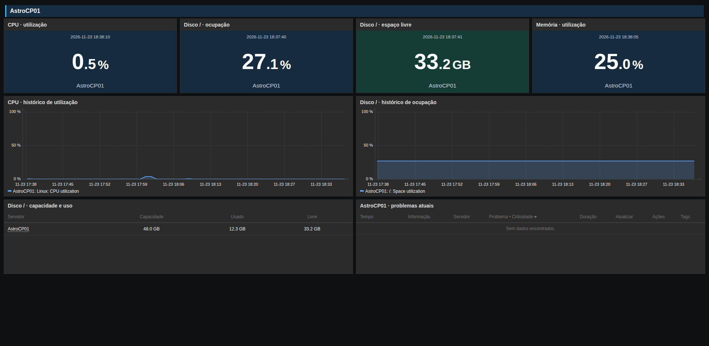

# Dashboard GEST

O dashboard **GEST · Operação e servidores** reúne a operação em nove páginas. A troca
automática de página fica desligada para manter a visão escolhida na tela.
Em telas menores, o controle nativo para recolher o menu lateral libera espaço
para os cartões e tabelas; a configuração foi conferida também nesse modo.

Cada página tem uma faixa azul de **32 pixels** no topo com o seu nome, como **AstroCP01**,
**Banco AtivBenefícios Prod** ou **UrTelecom · OLT ZTE Titan**. A identificação
mostra somente o nome e continua visível no **modo de quiosque/tela cheia**,
mesmo quando as abas e a navegação ficam ocultas. Durante o slideshow, o nome
acompanha a página exibida.



| Página | Conteúdo |
| --- | --- |
| Visão geral | Resumo da operação, disponibilidade de agentes e SNMP, relógio de Brasília, comparação dos servidores, problemas atuais, resumo HTTPS e log de ações |
| Servidores | Comparação por host de ocupação do disco, espaço livre, CPU e memória; gráficos comparativos de CPU e disco; problemas dos servidores |
| AtivBenefícios · Web | CPU, ocupação e espaço livre do disco, processos Nginx e PHP-FPM; gráficos e capacidade do disco; problemas exclusivamente do servidor web |
| Banco AtivBenefícios Prod | CPU, ocupação e espaço livre do disco e disponibilidade MySQL exclusivamente desse host; gráficos e capacidade do disco; problemas do banco |
| AstroCP01 | CPU, ocupação e espaço livre do disco e memória exclusivamente desse host; gráficos e capacidade do disco; problemas do host |
| AstroCP02 | CPU, ocupação e espaço livre do disco e memória exclusivamente desse host; gráficos e capacidade do disco; problemas do host |
| Aplicações | Retorno HTTP do site AtivBenefícios, front e API GestClin; resultado dos cenários HTTPS; problemas das aplicações; histórico do tempo de resposta |
| Infraestrutura | Informações do sistema Zabbix, disponibilidade SNMP, problemas de rede e capacidade dos servidores Linux |
| UrTelecom · OLT ZTE Titan | Resumo compacto em uma tela: SNMP, CPU, memória, uptime, ONUs, tráfego Ethernet e problemas da OLT; incluído na sequência do slideshow |

Os indicadores usam os itens existentes dos hosts. O item de espaço livre foi
adicionado aos templates **GEST-cpu-hd-mysql** e **GEST-cpu-hd-nginx-php**. A disponibilidade MySQL recebeu um
mapeamento de valores para apresentar o estado por extenso. As verificações
MySQL continuam limitadas a processo e porta local, sem conta SQL.

Os servidores Astro também recebem o item nativo `vfs.fs.size[/,free]`, sem
alterar os itens ou alertas preexistentes. A tabela comparativa organiza uma
linha por host e ordena pela maior ocupação do disco. As páginas individuais
mostram o nome completo do host nos cartões e restringem itens, gráficos e
problemas àquela máquina. O comparativo inclui banco, servidor web e os dois
Astro. Os indicadores MySQL ficam na página do banco; Nginx e PHP-FPM ficam na
página do servidor web. Os cartões dos serviços exibem o estado e a quantidade
de processos encontrada pelo agente.

O disco comparado é o sistema de arquivos raiz `/`. O espaço livre representa
a capacidade disponível reportada pelo agente; reservas do sistema de arquivos
podem fazer esse número diferir da capacidade total menos o espaço usado.

## Cores e atualização

- CPU: barras verdes nas comparações e cartões azul-escuros na condição normal;
  âmbar a partir de 70% e vermelho a partir de 90%.
- Ocupação do disco: âmbar a partir de 90% e vermelho a partir de 95%. As cores
  do comparativo são referências visuais; as notificações efetivas seguem as
  regras de cada host. Os limites GEST de 90%/95% estão configurados no banco e
  no servidor web.
- Espaço livre: vermelho abaixo de 5 GiB, âmbar entre 5 e 10 GiB e verde a partir
  de 10 GiB. Essas cores representam espaço livre absoluto; as notificações de
  ocupação são independentes e usam os limites GEST de 90% e 95% por três coletas
  consecutivas.
- MySQL: verde para porta disponível e vermelho para indisponível.
- Nginx e PHP-FPM: verde quando há processos e vermelho quando a contagem é zero.
  Os alertas de serviço parado exigem três coletas consecutivas sem processos.
- HTTP: verde para código 200, âmbar para outros códigos entre 201 e 399 e
  vermelho para ausência de resposta ou erros a partir de 400. O resultado dos
  cenários HTTPS e os problemas complementam esses cartões.

Os cartões mostram o horário da amostra. A atualização de 30 segundos dos
widgets consulta o último valor disponível; a frequência de coleta continua
sendo a dos itens. Os gráficos atualizam a cada minuto e acompanham o período
selecionado no dashboard. Ao perder dados, deve-se conferir a hora da última
amostra e os problemas de disponibilidade; uma leitura antiga não confirma o
estado atual do serviço.

## Log de ações e preservação

O widget **Log de ações** permanece na página principal, com largura total.
Foram preservados o ID do widget, seus filtros e sua atualização original de
120 segundos. Ele continua exibindo os registros existentes de envio, execução
e falha. Nenhuma ação, mensagem, destinatário ou histórico foi alterado pela
reorganização do dashboard.

O dashboard conserva sua identidade, proprietário e compartilhamentos. Os
demais dashboards existentes também são preservados. A informação do sistema,
antes na página principal, está disponível na aba Infraestrutura.

A configuração anterior foi salva fora do projeto, em
`~/.local/share/alert-zabbix/backups/dashboard-1-before-layout-*.json`, com
permissão 600. A organização anterior à separação por host fica em
`dashboard-1-before-host-groups-*.json`, no mesmo diretório. A cópia anterior à
inclusão do servidor web usa `dashboard-1-before-web-server-*.json`. Esses arquivos
contêm os vínculos reais com hosts e itens e
devem permanecer fora do pacote do aplicativo. Para reverter, use a API
`dashboard.update` com as propriedades editáveis da cópia correspondente;
widgets removidos precisam ser recriados sem reutilizar IDs excluídos.

Referências: [dashboards](https://www.zabbix.com/documentation/6.4/en/manual/web_interface/frontend_sections/dashboards)
e [API dashboard.update](https://www.zabbix.com/documentation/6.4/en/manual/api/reference/dashboard/update).

## Identificação no quiosque

O [módulo GEST](modules/gest-dashboard-title) do frontend mostra a identificação
fora da grade de widgets, com altura de **32 px** e texto de **16 px**. Usa o
nome da página selecionada pelo próprio dashboard, atualizando também nas
passagens automáticas. Não consulta itens, credenciais ou serviços externos.
Seu escopo é o dashboard operacional de ID `1`.

O módulo está instalado em `/usr/share/zabbix/modules/gest-dashboard-title` na
VM do Zabbix e ativado na administração de módulos. Não modifica arquivos nativos
do frontend. Para reinstalar, copie a pasta de mesmo nome do repositório para
`/usr/share/zabbix/modules/`, busque novos módulos na tela **Módulos** e habilite
**GEST · Identificação compacta do dashboard**. Recarregue a página após instalar
ou atualizar os arquivos.

O [configurador de títulos](configurar_titulos_dashboard.py) migra a versão antiga
com cartões grandes: exige o módulo ativo, salva um backup privado, remove só
os cartões `Identificação · ...` e devolve seu espaço aos widgets existentes.
Reaplicações não deslocam o conteúdo novamente:

```bash
python3 zabbix/configurar_titulos_dashboard.py --apply
```

O configurador usa a conexão do aplicativo; conserva os IDs, conteúdos, filtros,
tamanhos e posições originais dos 67 widgets operacionais, incluindo o log de
ações. O backup usa `gest-before-page-titles-*.json`; o
[snapshot das identificações](dashboards/gest-identificacoes.json) registra o
módulo e as páginas desta instância. O resumo da OLT recebe a faixa automaticamente,
sem precisar reservar linhas extras. Para ocultar a faixa, desabilite o módulo.

As nove identificações foram verificadas no quiosque em 1920 × 1080. A troca
automática de AstroCP01 para AstroCP02 foi conferida com o título correspondente.
O intervalo permanece em 30 segundos; o slideshow foi parado após o teste.

## Dashboard UrTelecom · OLT ZTE Titan

A OLT tem um painel próprio com seis páginas: visão geral, GPON, VLANs, uplinks, hardware/óptica e eventos/notificações. Os detalhes, capturas e instruções de manutenção estão em [ZTE-TITAN.md](ZTE-TITAN.md#dashboard-da-olt).
