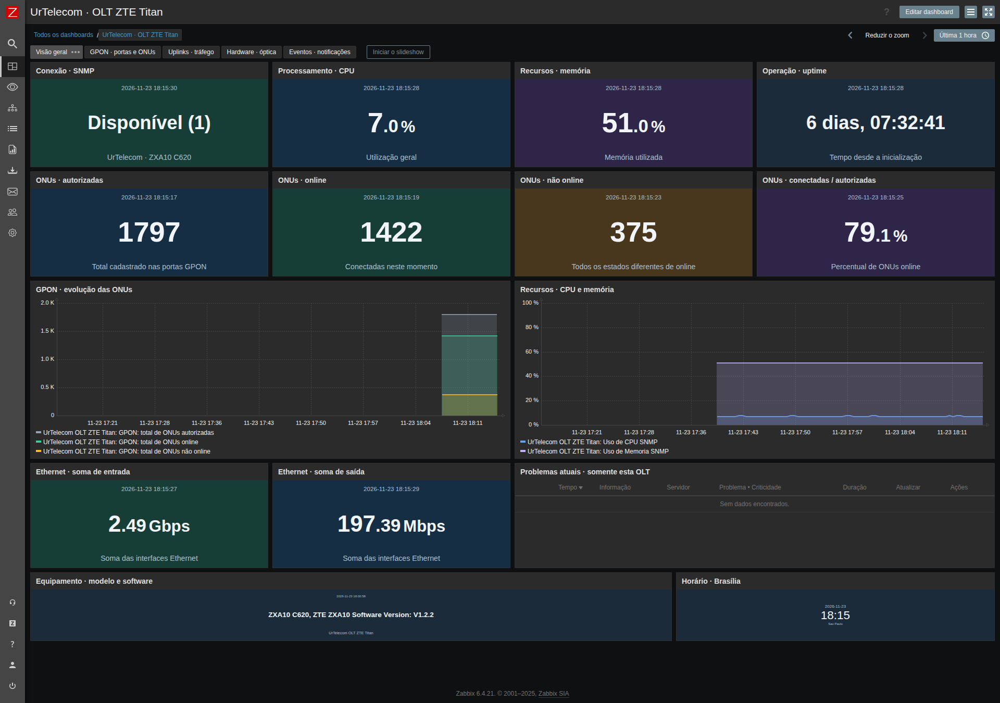
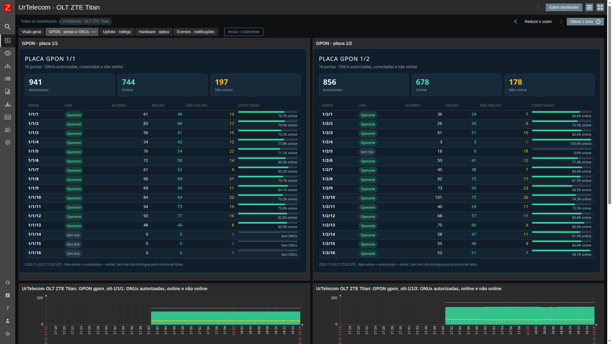
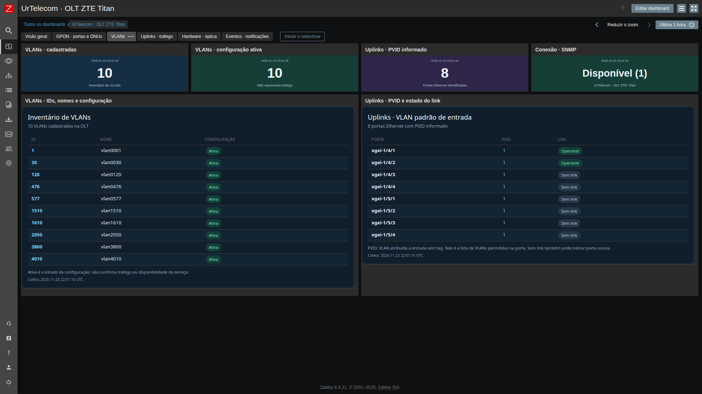
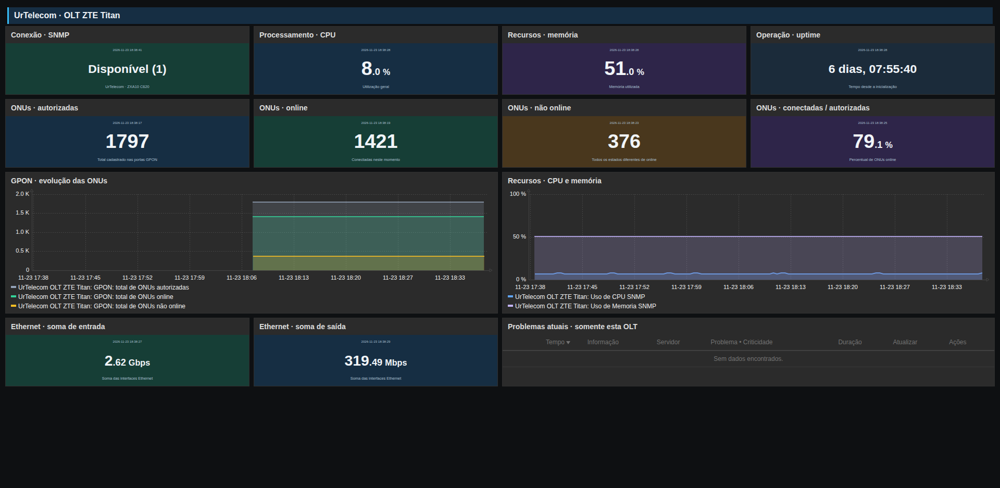

# ZTE TITAN · UrTelecom

A OLT **UrTelecom OLT ZTE Titan** foi cadastrada no Zabbix 6.4.21 no grupo **UrTelecom**.

| Configuração | Valor |
| --- | --- |
| Modelo confirmado por SNMP | ZTE ZXA10 C620 |
| Software informado pelo equipamento | V1.2.2 |
| Endereço | `187.49.175.1` |
| Protocolo | SNMP v2c, UDP **2161** |
| Template | `GEST - ZTE TITAN C6xx SNMP` |
| Comunidade | Macro **secreta** `{$SNMP_COMMUNITY}` no host, somente leitura |

A comunidade de leitura e escrita não é necessária nem foi cadastrada.

## O que é coletado

- CPU e memória gerais, uptime, modelo e nome do equipamento.
- Identificação de placas e CPU por placa.
- Estado das interfaces e tráfego de entrada/saída das interfaces Ethernet em 64 bits.
- Quantidade de ONUs autorizadas e online por porta GPON.
- ONUs no estado **7**, mantendo o critério do script original.
- Total de ONUs **não online**, calculado por autorizadas menos online. Esse total inclui outros estados além do 7.
- Medição óptica do OID do material original, com escala `/1000`. O valor sentinela `2147483647` é descartado e excluído da descoberta. Sete medições sem qualquer leitura válida foram removidas; serão descobertas automaticamente se o equipamento passar a fornecer valores válidos. A unidade precisa ser confirmada no MIB antes de definir limites ópticos.

CPU, memória, estado das interfaces, tráfego e contagens GPON usam intervalos de 30 segundos. Os estados detalhados das ONUs e dados por placa são coletados a cada minuto. A descoberta ocorre a cada hora; a descoberta inicial foi solicitada pela API.

A descoberta de memória **por placa** permanece desabilitada: o equipamento retornou zero em todas as placas consultadas. A memória geral respondeu normalmente e está ativa.

## Alertas e WhatsApp

O template fornecido não continha gatilhos. A adaptação acrescenta:

- Comunicação SNMP marcada como indisponível por 30 segundos. A detecção também depende dos tempos de timeout/reconsulta do poller SNMP; não representa uma garantia de entrega em 30 segundos.
- CPU acima de 90% durante um minuto.
- Memória acima de 90% durante um minuto.

Como o host pertence ao grupo **UrTelecom**, seus eventos atendem ao filtro da ação existente **Alerta WhatsApp UrTelecom**, que usa a mídia **WhatsApp Ur Telecom**. As ações globais existentes continuam se aplicando. Não foi provocada uma falha nem enviada uma mensagem manual de teste durante o cadastro.

## Arquivos e manutenção

- [Template importável no Zabbix 6.4](templates/gest-zte-titan-c6xx.yaml).
- [Gerador da adaptação](preparar_template_zte_titan.py).
- Material original preservado em `../zte titan 6xx/`, com autoria Bee Solutions.

O helper externo `ponzte620` do material original assumia UDP 161. A adaptação usa um único item SNMP `walk[]` compartilhado e itens dependentes, respeitando a porta configurada na interface. Não é necessário instalar o helper em `externalscripts`.

Para reconstruir a adaptação a partir do XML original:

```bash
python3 zabbix/preparar_template_zte_titan.py /tmp/gest-zte-titan.xml
```

O YAML exportado é a referência para importar no Zabbix 6.4. Ao criar outro host, ajuste IP/porta e cadastre sua própria macro secreta `{$SNMP_COMMUNITY}`. O template e o gerador não contêm a comunidade.

O arquivo `dahsboard-c610-exemplo-beesolutions.com.br-v2.json` fornecido é um dashboard do **Grafana**, não um dashboard importável diretamente no Zabbix. Ele foi preservado sem alterações.

## Dashboard da OLT

[**Abrir UrTelecom · OLT ZTE Titan**](http://172.16.0.4/zabbix/zabbix.php?action=dashboard.view&dashboardid=317)

O painel tem seis páginas:

| Página | Informações |
| --- | --- |
| Visão geral | Disponibilidade SNMP, CPU, memória, uptime, totais de ONUs, percentual online, tráfego Ethernet agregado, problemas atuais e identificação da OLT |
| GPON · portas e ONUs | Tabelas das placas 1/1 e 1/2, com 16 portas cada, estado do link, autorizadas, online, não online e barras percentuais; histórico individual das 32 portas com paginação |
| VLANs | Inventário de IDs, nomes e estado da configuração; PVID e estado do link das oito interfaces Ethernet identificadas; totais cadastrados/ativos e disponibilidade SNMP |
| Uplinks · tráfego | Estado das oito interfaces Ethernet e gráficos de entrada/saída por interface; verde para operante e cinza para sem link |
| Hardware · óptica | CPU e identificação das seis posições de placa, histórico de CPU por placa e medições ópticas GPON na escala original |
| Eventos · notificações | Problemas da OLT, log de notificações filtrado pelo nome do host e comparação entre ONUs no estado 7 e o total não online |





Os cartões atualizam a cada 10 segundos, consultando o último valor disponível. A coleta e os totais calculados usam 30 segundos; os dados por placa continuam a cada minuto. O histórico dos totais começa na criação desses itens. Os gráficos por porta aproveitam os dados já coletados anteriormente.

**Não online** é a diferença entre autorizadas e online, incluindo todos os estados diferentes de online. **Estado 7** é uma contagem específica do OID ZTE, preservada separadamente. O percentual online representa ONUs conectadas sobre autorizadas; não mede a ocupação máxima/capacidade da porta.

As tabelas GPON mostram a hora da consulta em **UTC**, indicada no rodapé. Os demais widgets usam o fuso configurado no Zabbix, e o relógio da visão geral usa Brasília. O horário da última amostra deve ser conferido em caso de perda de comunicação.

A soma do tráfego Ethernet é a soma dos contadores das oito interfaces, por direção; não representa automaticamente tráfego único de assinantes. Uma porta sem link pode estar ociosa, desativada ou apresentar falha; o painel não conclui a causa apenas pelo estado operacional. Valores vazios de inventário indicam informação não fornecida pelo equipamento.

Os problemas são filtrados pelo host. O widget de notificações busca o nome completo da OLT no corpo das mensagens, abrangendo os canais existentes; mensagens que não incluam esse nome não aparecem nesse filtro. Nenhuma falha ou mensagem de teste foi provocada para preencher o painel. O dashboard operacional anterior e seu log de ações foram preservados.

### Manutenção do dashboard

- [Configurador pela API](configurar_dashboard_zte.py): resolve os IDs reais dos itens e preserva a identidade do dashboard em reaplicações.
- [Resumo GPON para pré-processamento](widgets/zte-gpon-summary.js): gera HTML sem scripts, validando portas e escapando texto antes da apresentação no widget nativo **Texto simples**.
- [Snapshot da configuração](dashboards/urtelecom-zte-titan.json): contém IDs desta instância; não é um arquivo de importação da interface do Zabbix.

```bash
python3 zabbix/configurar_dashboard_zte.py --apply
```

O configurador usa a conexão do aplicativo e cria um backup privado `zte-dashboard-before-*.json` antes de alterar o próprio painel. Ele acrescenta ao template os itens `zte.dashboard.*`, mapeamentos de apresentação e um protótipo de gráfico GPON. Os totais são calculados a partir dos itens existentes. As tabelas compartilham uma pequena coleta SNMP de nomes, estados e contagens GPON; seu HTML fica armazenado por uma hora. Os valores recebidos são validados, e uma porta sem dados não é apresentada como zero.

O YAML exportado já contém esses acréscimos. Se reconstruir o template a partir do XML original com `preparar_template_zte_titan.py`, execute também o configurador do dashboard para reconstruir seus complementos. As capturas foram verificadas com dados reais; o painel foi conferido também com largura de 1366 pixels.

### VLANs

A aba **VLANs** fica entre GPON e Uplinks no painel detalhado. Na implantação,
a OLT retornou dez VLANs: **1, 30, 120, 476, 577, 1510, 1610, 2050, 3800 e 4010**,
todas com configuração ativa. Os oito uplinks Ethernet retornaram PVID 1.
Esses valores são coletados novamente a cada minuto, não são fixos no painel.



As fontes são as tabelas SNMP somente leitura **Q-BRIDGE-MIB**, com nomes e
estado das VLANs, PVID, mapeamento bridge/ifIndex, nomes e estado operacional
das interfaces. O estado **Ativa** descreve a configuração da VLAN e não confirma
tráfego ou disponibilidade de um serviço. **PVID** é a VLAN atribuída à entrada
sem tag, conforme [Q-BRIDGE-MIB / RFC 4363](https://www.rfc-editor.org/rfc/rfc4363.html#section-4).
Ele não representa todas as VLANs permitidas em uma porta.

O bitmap de membros retornado pela ZTE não pôde ser relacionado de forma
inequívoca aos índices das interfaces publicados pela própria OLT. Por isso,
o painel apresenta os vínculos PVID validados e não atribui portas tagged/untagged
por suposição. Também não apresenta o tráfego Ethernet agregado como tráfego
individual de uma VLAN. A tabela PVID cobre os uplinks identificados como `xgei-*`;
não substitui a configuração de service-port/ONU.

O coletor `zte.dashboard.vlan.walk` executa um walk compartilhado a cada minuto,
sem histórico do texto bruto. Cinco itens dependentes geram três contadores e
duas tabelas HTML, com texto escapado antes da apresentação. Os contadores guardam
sete dias de histórico e 90 de tendências; o HTML fica armazenado por uma hora.
As tabelas mostram a hora da coleta em UTC; em perda de comunicação, confira essa
hora e a disponibilidade SNMP para não interpretar dados antigos como atuais.

Para criar ou atualizar essa única aba, preservando as demais:

```bash
python3 zabbix/configurar_vlans_zte.py --apply
```

O [configurador de VLANs](configurar_vlans_zte.py) usa a conexão do aplicativo,
salva backup privado `zte-before-vlans-*.json`, acrescenta os seis itens ao template
e mantém o ID da página em reaplicações. O configurador do painel principal da OLT
preserva páginas complementares como VLANs. Depois de reconstruir o template do
zero, execute também o configurador de VLANs. Nenhuma configuração de VLAN na OLT
é alterada; a coleta usa a macro secreta de comunidade somente leitura do host.


### Resumo no slideshow GEST

O dashboard [GEST · Operação e servidores](http://172.16.0.4/zabbix/zabbix.php?action=dashboard.view&dashboardid=1) também tem **uma única aba** chamada **UrTelecom · OLT ZTE Titan**, adicionada após Infraestrutura.

São 13 widgets de monitoramento organizados em dez linhas da grade, com uma faixa de identificação de 32 pixels acima: disponibilidade SNMP, CPU, memória, uptime, autorizadas, online, não online, percentual online, dois gráficos históricos, entrada/saída Ethernet e problemas atuais. O nome **UrTelecom · OLT ZTE Titan** permanece visível em tela cheia, mesmo com as abas ocultas. O resumo cabe em uma tela de 1920 × 1080 e entra na sequência ao clicar em **Iniciar o slideshow**. Herda o tempo atual de **30 segundos** por página. A passagem automática de Infraestrutura para a nova aba foi testada no navegador; o slideshow foi parado após a verificação.

As oito páginas anteriores, seus widgets, o log de ações, os compartilhamentos e as configurações de início do slideshow foram preservados. O painel detalhado da OLT continua disponível para consultar portas, placas e notificações.

Para recriar ou atualizar somente essa aba, sem duplicá-la:

```bash
python3 zabbix/configurar_dashboard_zte.py --main-page
```

O configurador salva uma cópia privada `gest-before-zte-summary-*.json` antes da alteração e confere a preservação das outras páginas. A faixa compacta é exibida pelo módulo GEST fora da grade e acompanha automaticamente o resumo atualizado. Para instalar a identificação, consulte [DASHBOARD.md](DASHBOARD.md#identificação-no-quiosque). O snapshot da aba fica em [gest-urtelecom-zte-resumo.json](dashboards/gest-urtelecom-zte-resumo.json).


